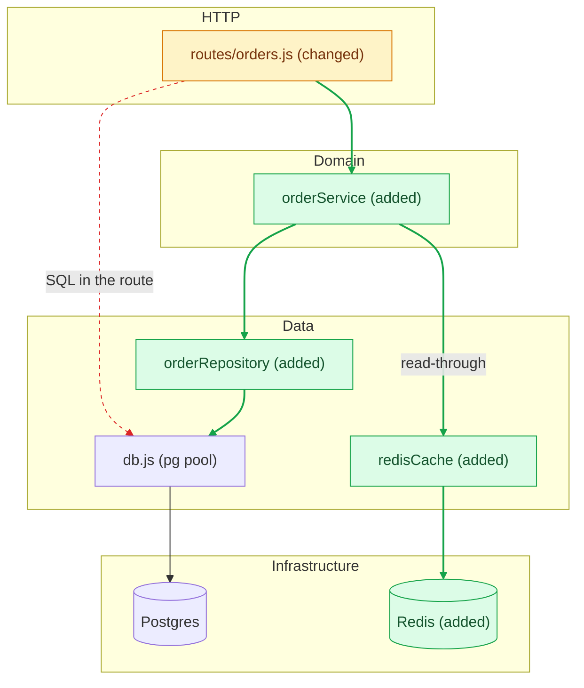
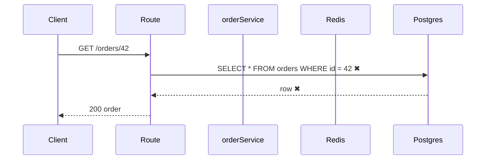
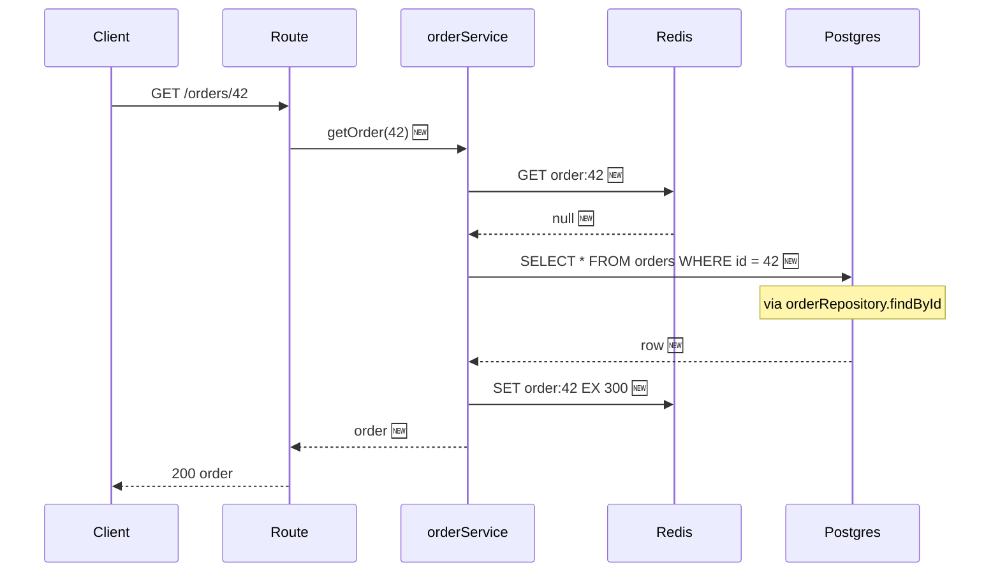
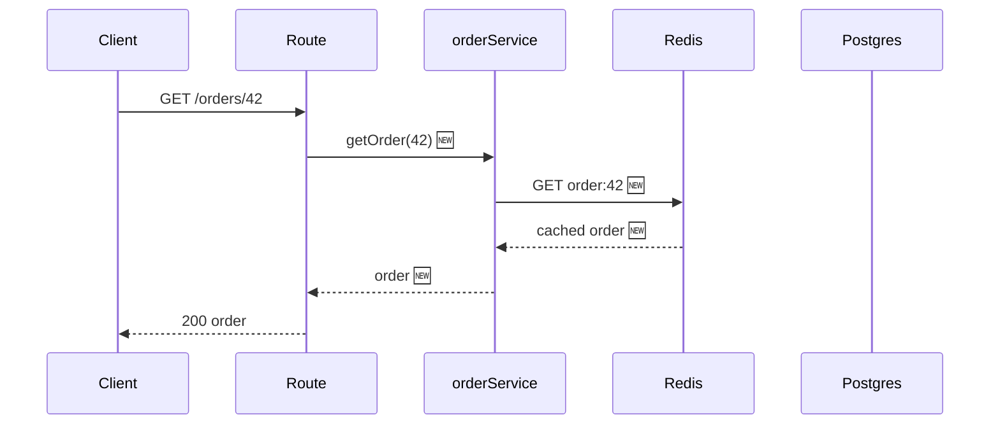
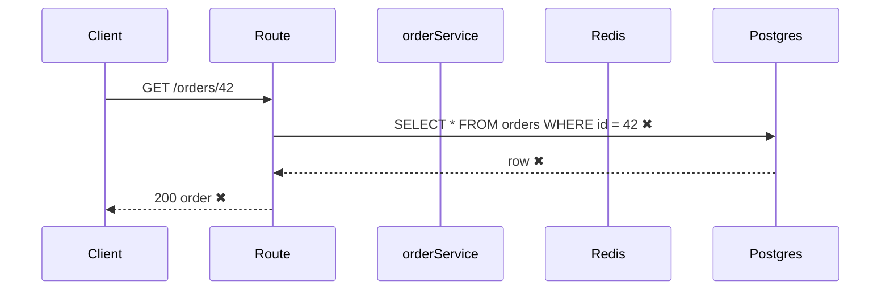
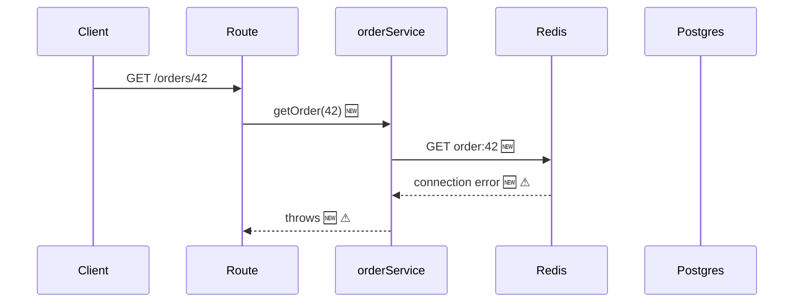
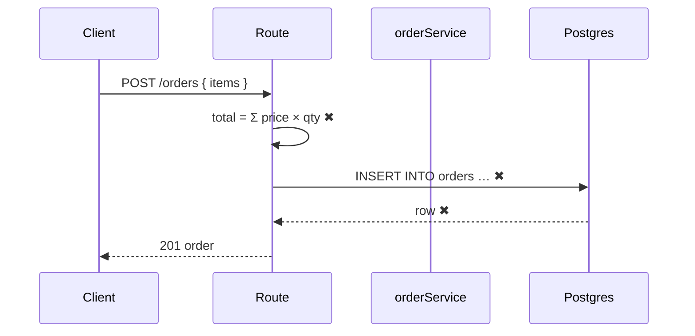
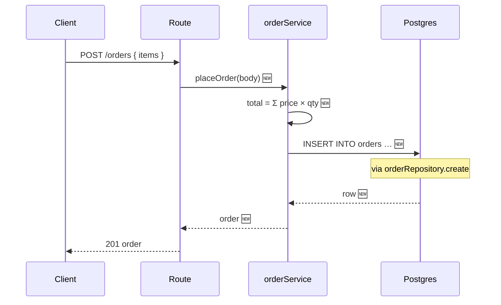
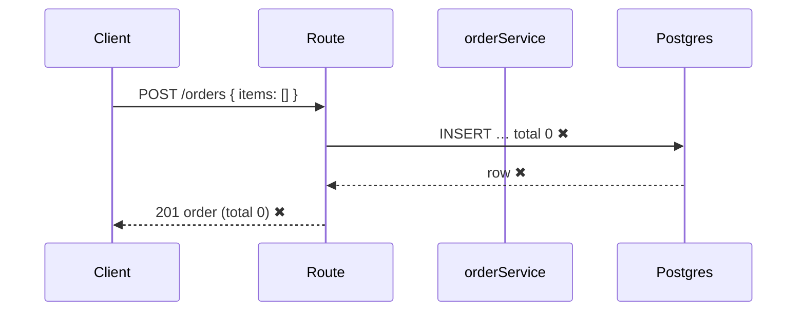
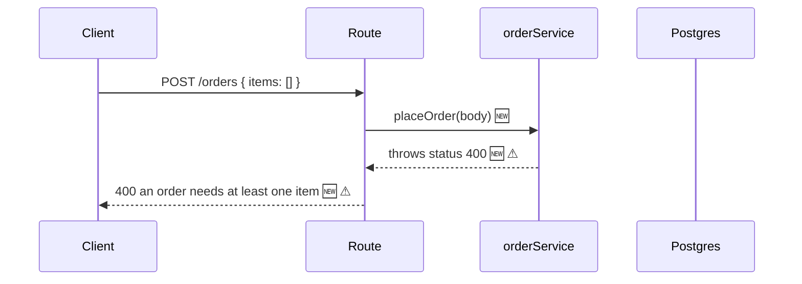

## What this change does

**Order requests now go route → service → repository, and reading an order is served from a 5-minute Redis cache before Postgres is asked.**

The routes stop running SQL themselves. Business rules (the total, the new empty-order check) move into `orderService`, SQL moves into `orderRepository`, and reads are cached in Redis. Redis becomes a new runtime dependency for GET /orders/:id.

acme-orders · feature/order-service-layer · 8 files · +95 −12 · effort 2/5

### Intent vs code (from commit messages)

| | Claim | Note |
|---|---|---|
| ✅ | Routes now call `orderService` | `src/routes/orders.js` imports only ../services/orderService. |
| ✅ | Reads go through a 5-minute Redis cache | `TTL_SECONDS = 300` in `redisCache.js`; only `getOrder` reads the cache. |
| ✅ | Empty orders are rejected with 400 | Also a body with no items array at all now gets 400; before, it threw on `items.reduce`. |

### Architecture impact

A classic three-layer split replaces route-level SQL, and a cache sits between the service and the database. The layering matches what CLAUDE.md asks for.

- **🟢 added module:** Service layer: orderService — Owns `getOrder` and `placeOrder`, including the order total and the empty-order rule.
- **🟢 added module:** Repository layer: orderRepository — The same two SQL statements the route used to run, now behind `findById` and create.
- **🟢 added dependency:** Redis via ioredis — New runtime dependency, configured by `REDIS_URL`. GET /orders/:id now needs Redis reachable.
- **🔴 removed boundary:** Routes no longer touch the database — The direct import of `src/db.js` from the route is gone.
- **🟢 added config:** New env var REDIS_URL — Read once at startup when `redisCache.js` is loaded.

| Convention | Source | Status | Note |
|---|---|---|---|
| Routes must never import `src/db.js` directly | CLAUDE.md | ✅ follows | Before this change the route did exactly that; now it doesn't. |
| Business rules live in src/services/, data access in src/repositories/ | CLAUDE.md | ✅ follows | The total and the new validation are in the service; SQL is in the repository. |
| New infrastructure dependencies need a note in `docs/architecture.md` | CLAUDE.md | ✅ follows | `docs/architecture.md` mentions Redis, but the file is still untracked: it is not committed yet. |
| Caching layer called from services | (no rule) | 🆕 new pattern | First cache in the codebase; nothing documents where caching may live. |

### Flow: GET /orders/:id

Reading one order. The route asks the service, which checks Redis before the database.

**Not in cache** — A miss costs one extra Redis round trip and stores the order for 5 minutes.

Before this change

**In cache** — Postgres is not asked at all; the answer can be up to 5 minutes old.

Before this change

**Redis unreachable** — The read fails even though Postgres is up: nothing catches the cache error. (Unchecked: what the client sees depends on Express error handling.)

Before this change

### Flow: POST /orders

Placing an order. Validation and the total move into the service.

**Valid order** — Same result as before; the work just happens in the service.

Before this change

**Empty items** — Rejected before anything is written.

Before this change

### Decisions made

- **Read-through cache in the service.** Chose caching inside orderService.getOrder over caching in the route or the repository. Keeps the route thin and the repository a plain SQL wrapper; the service decides what is cacheable. `src/services/orderService.js:6-12`
- **Validation errors carry an HTTP status.** Chose an Error with err.status = 400 over a dedicated error class. Lets the route map it to a 400 with one check; other errors go to next(). `src/services/orderService.js:15-19`, ``src/routes/orders.js``
- **Fixed 5-minute TTL, no invalidation.** Chose expire after 300 s over deleting the key on writes. Simplest option; `cache.del` exists but nothing calls it yet. `src/cache/redisCache.js:4`

### Worth a closer look

- **[Behaviour change] Reads can be up to 5 minutes stale** — Nothing deletes order:<id> when an order changes. Today there is no update route, so it only matters once one is added. _(step 3)_
- **[New dependency] GET /orders/:id now fails when Redis is down** — `getOrder` awaits `cache.get` with no fallback to the repository. _(step 3)_
- **[Uncommitted] The tests and the architecture note are not committed** — `test/orderService.test.js` and `docs/architecture.md` exist only in the working tree. _(step 5)_

### Walkthrough

| Step | What | Files |
|---|---|---|
| 1 | **Move the SQL into an order repository** — `orderRepository` wraps the two statements the route used to run: `findById` returns the row or null, create inserts and returns the new row. | `src/repositories/orderRepository.js` |
| 2 | **Add a Redis cache with a 5-minute expiry** — `redisCache` connects once at load using `REDIS_URL` and stores JSON values with a 300-second TTL. | `src/cache/redisCache.js` `package.json` |
| 3 | **Put the order rules in a service** — `orderService.getOrder` reads through the cache; `placeOrder` validates the items and computes the total before calling the repository. | `src/services/orderService.js` |
| 4 | **Thin the routes down to calls into the service** — The route now imports `orderService` instead of db and maps results to HTTP: null → 404, `err.status` 400 → 400, anything else → `next(err)`. | `src/routes/orders.js` |
| 5 | **Test the cache hit and the empty-order rule, and document Redis** — Two node:test cases mock the cache and repository; `docs/architecture.md` records the new request path and `REDIS_URL`. | `test/orderService.test.js` `docs/architecture.md` |

### What stopped happening

- Empty orders are no longer stored with a total of 0 — `placeOrder` throws a 400 before the insert. `src/services/orderService.js`
- GET no longer always reads fresh data from Postgres — A cached copy is returned for up to 5 minutes. `src/services/orderService.js`

Files you can skip

- **Lockfile** — Regenerated for `ioredis`.: `package-lock.json`

Not verified (needs running the code)

- What a client receives when Redis is unreachable (depends on Express 4's handling of a rejected async handler).
- That `ioredis` 5.4.1 accepts the (key, value, 'EX', seconds) call form used in set().

Generated by [explain-pr](https://github.com/rodriguesnavil/explain-pr) at 4f43a17.
