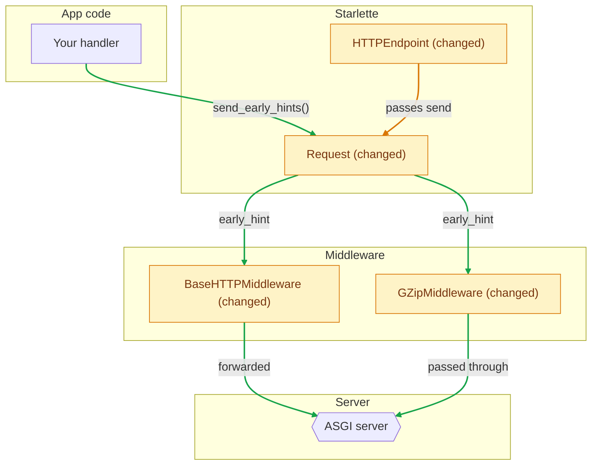
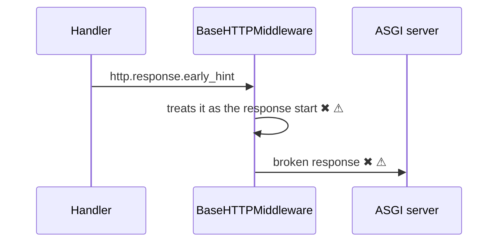
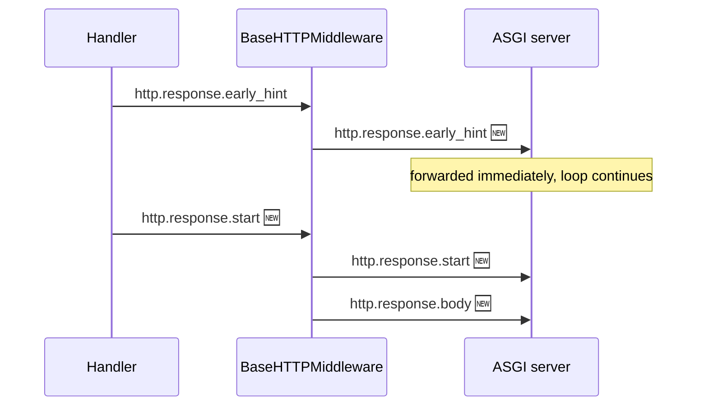
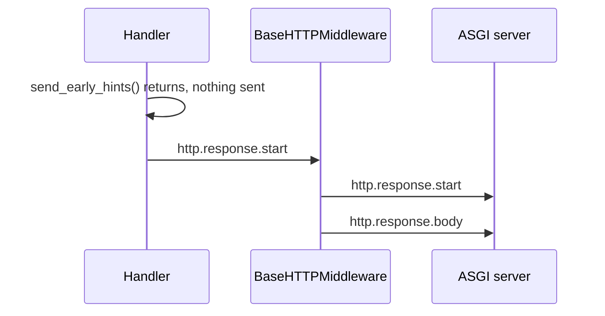

## What this PR does

**Handlers can now call `request.send_early_hints(...)` to send a 103 Early Hints response before the real one, and both `BaseHTTPMiddleware` and `GZipMiddleware` now pass those hints through instead of breaking on or dropping them.**

It's a new public method on `Request`, plus two pieces of plumbing so the method actually reaches the server. Class-based endpoints now give their `Request` a real `send` channel, and the two middlewares that sit between the app and the server learn about the `http.response.early_hint` ASGI message. Without the server's extension, the method does nothing.

encode/starlette #3435 · 10 files · +240 −9 · effort 2/5

### Intent vs code (from commit messages)

| | Claim | Note |
|---|---|---|
| ✅ | Add HTTP Early Hints support | `Request.send_early_hints` sends `http.response.early_hint` with the links encoded as latin-1 bytes. |
| ✅ | Make Early Hints links positional | Signature is `send_early_hints(link, /, *additional_links)`: at least one link, no keywords. |
| ✅ | Assert no Early Hints are sent without the extension | The method checks `scope["extensions"]` and returns silently when the server doesn't advertise the extension. |
| ✅ | Group GZip passthrough events | `early_hint` joins `trailers` in the same pass-through branch of `IdentityResponder.send`. |
| ➖ | (not stated) Class-based endpoints get a send channel | `HTTPEndpoint.dispatch` now passes `send=self.send`. That also makes `request.send_push_promise` work in `HTTPEndpoint`s, where it used to raise. |

### Architecture impact

No new modules or dependencies. The change adds one public API and teaches the request path (endpoint → middleware → server) about one more ASGI message type that can arrive before `http.response.start`.

- **🟢 added api:** `Request.send_early_hints(link, *additional_links)` — New public coroutine; a no-op unless the server advertises the `http.response.early_hint` extension.
- **🟠 changed boundary:** `HTTPEndpoint` requests can write to the response channel — The endpoint's `Request` now holds the real ASGI `send`, not the raising `empty_send`.
- **🟠 changed module:** `BaseHTTPMiddleware` forwards pre-response messages — It now reads messages in a loop until the response start, forwarding early hints to the server and recording debug info.
- **🟠 changed module:** `GZipMiddleware` passes early hints through — Before, an `early_hint` message matched no branch and was silently dropped.

| Convention | Source | Status | Note |
|---|---|---|---|
| After each heading, include text explaining the section before any code snippets | AGENTS.md | ✅ follows | docs/early-hints.md opens each section with prose before its example. |

### Flow: Through BaseHTTPMiddleware

A handler sends one hint, then returns a response, behind a `BaseHTTPMiddleware`.

**Server supports early hints** — The 103 goes out first, then the normal response.

Before this change

**Server without the extension** — Same as a request without hints: the call is a silent no-op.

### Decisions made

- **No-op without the server extension.** Chose silently skip over raising an error. Handlers can call it unconditionally; only servers that advertise `http.response.early_hint` receive anything. `starlette/requests.py:351`
- **Positional-only links.** Chose `link, /, *additional_links` over a list argument or keywords. At least one link is required by the signature itself. Each link is a full `Link` header value. `starlette/requests.py:350`
- **Forward hints inside the middleware's read loop.** Chose a `while True` loop that forwards `early_hint` and keeps reading over buffering them until the response starts. Hints are useful only if they reach the client before the response, so they go to the server as soon as they arrive. `starlette/middleware/base.py:156-165`

### Worth a closer look

- **[Subtle] BaseHTTPMiddleware now reads any number of pre-response messages** — The old code read one message, plus one more only if the first was a debug message. Now it loops past every `debug` and `early_hint` message until something else arrives. _(step 2)_
- **[Behaviour change] `send_push_promise` now works in `HTTPEndpoint`s** — It's a side effect of passing `send`: before, the endpoint's Request held `empty_send`, which raises when called. _(step 1)_

### Walkthrough

| Step | What | Files |
|---|---|---|
| 1 | **Add `send_early_hints` and give endpoint requests a send channel** — `Request.send_early_hints` encodes each link as latin-1 and sends one `http.response.early_hint` message, but only when the scope's extensions include it. `HTTPEndpoint.dispatch` now builds its Request with `send=self.send`, so the call can reach the server. | `starlette/requests.py` `starlette/endpoints.py` |
| 2 | **Let `BaseHTTPMiddleware` forward hints while it waits for the response** — `_CachedRequest` now takes `send` like `Request` does. The read of the app's first message becomes a loop: `debug` messages are recorded, `early_hint` messages are sent straight to the server, and the first other message ends the loop as before. | `starlette/middleware/base.py` |
| 3 | **Pass early hints through GZip untouched** — `IdentityResponder.send` groups `http.response.early_hint` with `http.response.trailers` in the branch that forwards the message as-is. | `starlette/middleware/gzip.py` |
| 4 | **Test the method, the endpoint, and both middlewares** — Each test sends a hint and asserts the message order the server sees: `early_hint` first, then `http.response.start`, then the body. Two request tests cover the no-extension and no-send-channel cases. | `tests/test_requests.py` `tests/test_endpoints.py` `tests/middleware/test_base.py` `tests/middleware/test_gzip.py` |

### What stopped happening

- GZipMiddleware no longer drops `http.response.early_hint` messages — They used to match no branch in `IdentityResponder.send`. `starlette/middleware/gzip.py`
- Requests in `HTTPEndpoint` no longer hold the raising `empty_send` — They get the real `send`. `starlette/endpoints.py`

Files you can skip

- **Docs** — A usage page for the new method and its nav entry.: `docs/early-hints.md`, `mkdocs.yml`

Not verified (needs running the code)

- What a real server (Hypercorn, Granian) sends to the browser for these messages; the tests use fake send callables.
- Exactly how the old `BaseHTTPMiddleware` would have failed on an early hint arriving first.

Generated by [explain-pr](https://github.com/rodriguesnavil/explain-pr) at 1677452.
